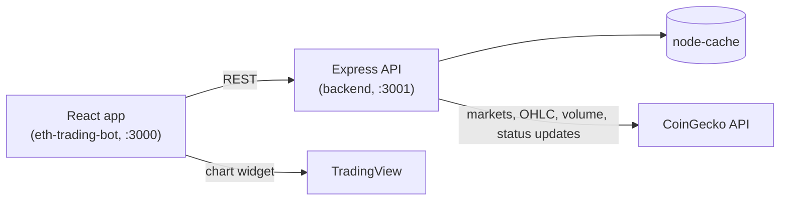

<div align="center">

# CryptoVault

A crypto market dashboard with technical-indicator signals, coin drill-downs and simulated portfolio tools, built with React and an Express API.


</div>

## Overview

CryptoVault pulls live market data for the top cryptocurrencies from the public CoinGecko API. It runs RSI and MACD analysis on each coin's recent price history and shows the results in a single-page React dashboard. A small Express backend proxies and caches the CoinGecko requests and computes the Buy, Sell and Hold signals. The frontend renders cards, charts, a coin detail view and simple portfolio and simulation tools.

> This is an educational project. Its signals are simple indicator rules, not financial advice, and no real trades are placed.

## Features

- **Market overview**: the top 10 coins by market cap, with price, 24-hour change, a sparkline and a signal badge (Chart.js).
- **Indicator-based signals**: the backend computes 14-period RSI and MACD (12/26/9) with `technicalindicators`. It labels a coin **Buy** when RSI < 40 and the MACD histogram > 0, and **Sell** when RSI > 60 and the histogram < 0.
- **Top recommendations**: the best-scoring Buy and Sell picks out of the top 20 coins, with a Buy/Sell toggle.
- **Coin detail view** with four tabs:
  - **Chart**: an embedded TradingView widget (`BINANCE:<SYMBOL>USDT`).
  - **Technical analysis**: RSI, MACD, Bollinger Bands and SMA 20/50 charts computed in the browser (Recharts).
  - **News and sentiment**: CoinGecko status updates scored with the `sentiment` library (positive, negative or neutral).
  - **Volume analysis**: daily volume as stacked bars, over a selectable number of days.
- **Portfolio builder**: add holdings from the loaded coins and see their total value at current prices and the profit or loss against your initial investment (kept in memory only).
- **Trading simulation**: choose a strategy (SMA crossover, MACD or RSI) and a timeframe, then run a mock simulation through the API.
- **Resilient UI**: loading spinners, error alerts with a retry button, and a top-level error boundary. Styles adapt to Chakra's color mode.
- **Caching and rate limiting**: `node-cache` (5-minute TTL) and at least 10 seconds between upstream CoinGecko calls, to stay within the free-tier limits.

## Tech stack

| Layer | Technology |
| --- | --- |
| Frontend | React 18, TypeScript, Create React App, Chakra UI, Framer Motion |
| Charts | Chart.js (`react-chartjs-2`), Recharts, TradingView embed |
| Backend | Node.js, Express 4, TypeScript (`ts-node` / `nodemon`) |
| Analysis | `technicalindicators` (RSI, MACD, Bollinger Bands, SMA), `sentiment` |
| Data | CoinGecko REST API, `node-cache` |

## Architecture



## Project structure

```
CryptoVault/
├── backend/                       # Express API
│   ├── .env.example
│   └── src/
│       ├── server.ts              # Routes and CORS setup
│       └── services/
│           ├── cryptoService.ts   # CoinGecko client, caching, RSI/MACD signals
│           ├── sentimentAnalysis.ts
│           └── ...                # ethService, paperTrading, technicalAnalysis helpers
└── eth-trading-bot/               # React frontend (Create React App)
    ├── .env.example
    └── src/
        ├── App.tsx
        └── components/
            ├── UltraAdvancedCryptoTrading.tsx   # Main page
            ├── Dashboard.tsx, TopRecommendations.tsx
            ├── CoinDetail.tsx, TechnicalAnalysis.tsx, VolumeAnalysis.tsx, NewsSentiment.tsx
            └── Portfolio.tsx, TradingSimulation.tsx, TradingViewWidget.tsx
```

## Getting started

### Prerequisites

- Node.js 16 or newer and npm

### 1. Backend

```bash
cd backend
npm install
cp .env.example .env    # then fill in values
npm run dev             # nodemon + ts-node on http://localhost:3001
```

To run a production build, use `npm run build && npm start`.

### 2. Frontend

```bash
cd eth-trading-bot
npm install
cp .env.example .env    # optional, see below
npm start               # http://localhost:3000
```

Other scripts: `npm run build` and `npm test`.

### Environment variables

| Variable | Location | Description |
| --- | --- | --- |
| `PORT` | `backend/.env` | Port for the Express API (defaults to `3001`) |
| `CRYPTOCOMPARE_API_KEY` | `backend/.env` | CryptoCompare API key. Listed in the template, but the current backend code does not read it. |
| `REACT_APP_CRYPTOPANIC_TOKEN` | `eth-trading-bot/.env` | CryptoPanic API token used by the `NewsFeeds` component |

## API

| Method | Path | Description |
| --- | --- | --- |
| `GET` | `/api/coins-with-analysis` | Top 10 coins, then their RSI/MACD analysis, streamed as two newline-delimited JSON chunks |
| `GET` | `/api/top-recommendations` | Top 3 Buy and top 3 Sell picks out of the top 20 coins |
| `GET` | `/api/coin/:id?timeframe=1M` | CoinGecko coin details plus OHLC history (`1M`, `3M`, or one year otherwise) |
| `GET` | `/api/historical-data/:id?timeframe=&interval=` | OHLC history for one coin |
| `GET` | `/api/historical-data` | 30-day Bitcoin OHLC history |
| `GET` | `/api/current-price` | Price of the top coin by market cap |
| `GET` | `/api/volume/:id?days=30` | Daily volume, split into buy and sell volume |
| `GET` | `/api/news/:id` | Latest 5 status updates with sentiment scores |
| `POST` | `/api/simulate-trading` | Body `{ initialInvestment }`. Returns a final value and profit. |

## Notes and limitations

- **Mock data in places**: `/api/simulate-trading` returns a random -10% to +10% outcome and ignores the chosen strategy and timeframe. The buy/sell split in `/api/volume` is randomly generated from total volume. The "Portfolio Value" card on the main page shows a static placeholder.
- **Hard-coded URLs**: the frontend calls `http://localhost:3001`, and the backend's CORS setting only allows `http://localhost:3000`.
- **Unused code**: `NewsFeeds` (the only consumer of `REACT_APP_CRYPTOPANIC_TOKEN`), `ColorModeSwitcher`, `AdvancedChart`, `CryptoTracker`, `PriceChart` and a few backend services (`ethService`, `paperTrading`) are present but not wired into the current UI or routes.
- **Rate limits**: the free CoinGecko API is rate-limited. The 10-second spacing between requests makes the first load slow, and later loads use the cache.
- **Client-side token**: any `REACT_APP_*` value is bundled into the browser build and is visible to users.

---

Built by [Abhishek Yadav](https://github.com/abhiishek340)
